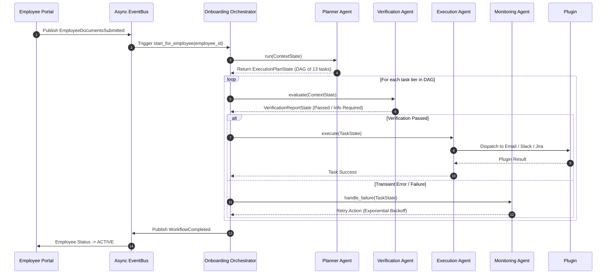
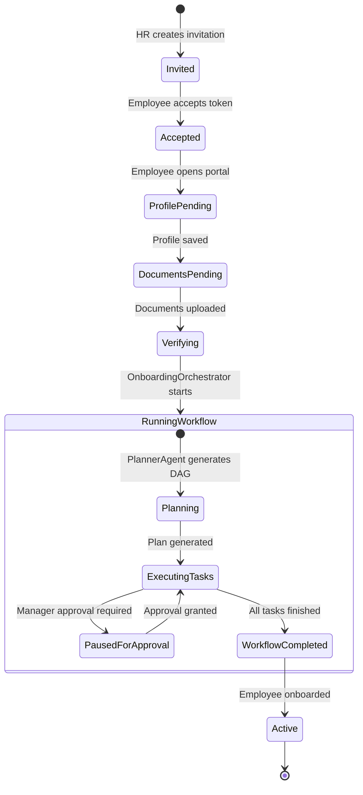
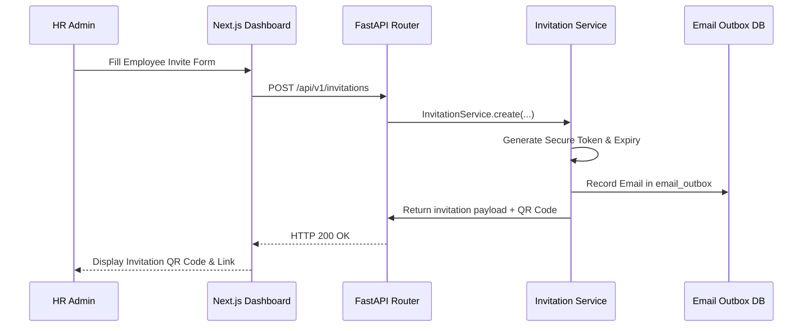

# 📐 ECHO WorkforceOS - Architecture Documentation

This document provides a deep architectural walkthrough of **ECHO WorkforceOS**, covering the multi-agent framework, state management model, workflow execution pipeline, event bus, and database persistence layer.

---

## 1. High-Level Architecture

```mermaid
graph TB
    subgraph Client Layer
        FE[Next.js App Router]
        Portal[Employee Public Portal]
    end

    subgraph API & Control Layer
        FastAPI[FastAPI Gateway]
        Middleware[JWT / RBAC Middleware]
        Router[API Route Modules]
    end

    subgraph Service Layer
        AuthSvc[Auth Service]
        OnboardSvc[Onboarding Service]
        DocSvc[Document Service]
        NotifSvc[Notification Service]
    end

    subgraph Orchestrator & Multi-Agent Core
        Orchestration[Onboarding Orchestrator]
        Engine[Workflow Engine]
        RetryMgr[Retry & Escalation Manager]
        Planner[Planner Agent]
        Verifier[Verification Agent]
        Executor[Execution Agent]
        Monitor[Monitoring Agent]
    end

    subgraph Tool Plugins
        PluginRegistry[Tool Plugin Registry]
        Email[Email Plugin]
        Slack[Slack Plugin]
        Jira[Jira Plugin]
        Calendar[Calendar Plugin]
        Storage[Storage Plugin]
    end

    subgraph Persistence Layer
        DBAdapter{Database Adapter}
        SQLite[(SQLite Engine)]
        Supabase[(Supabase Client)]
    end

    FE -->|REST API| FastAPI
    Portal -->|Token REST API| FastAPI
    FastAPI --> Middleware
    Middleware --> Router
    Router --> Service Layer
    Service Layer --> Orchestration
    Orchestration --> Engine
    Engine --> Planner
    Engine --> Verifier
    Engine --> Executor
    Engine --> Monitor
    Executor --> PluginRegistry
    PluginRegistry --> Email
    PluginRegistry --> Slack
    PluginRegistry --> Jira
    PluginRegistry --> Calendar
    PluginRegistry --> Storage
    Service Layer --> DBAdapter
    Engine --> DBAdapter
    DBAdapter --> SQLite
    DBAdapter --> Supabase
```

---

## 2. Multi-Agent AI Framework

ECHO WorkforceOS implements a **Deterministic Multi-Agent State Machine**. Instead of relying solely on unconstrained LLM loops, agents operate over structured Pydantic state contracts (`ContextState`, `TaskState`, `ExecutionPlanState`, `VerificationReportState`).



---

## 3. Workflow State Machine Diagram



---

## 4. Request & Execution Sequence Flow



---

## 5. Database Schema (SQLite / Postgres)

### Core Tables

#### `employees`
- `id` (VARCHAR / UUID, Primary Key)
- `organization_id` (VARCHAR, Foreign Key)
- `first_name` (VARCHAR, NOT NULL)
- `last_name` (VARCHAR, NOT NULL)
- `email` (VARCHAR, UNIQUE, NOT NULL)
- `phone` (VARCHAR)
- `department` (VARCHAR)
- `job_title` (VARCHAR)
- `role` (VARCHAR, Default: `'employee'`)
- `status` (VARCHAR, Default: `'invited'`)
- `profile` (JSON / Text)
- `profile_completed` (BOOLEAN)
- `terms_accepted_at` (TIMESTAMP)
- `created_at` (TIMESTAMP)

#### `invitations`
- `id` (VARCHAR / UUID, Primary Key)
- `organization_id` (VARCHAR)
- `employee_id` (VARCHAR, Foreign Key)
- `email` (VARCHAR, NOT NULL)
- `token` (VARCHAR, UNIQUE, NOT NULL)
- `role` (VARCHAR)
- `status` (VARCHAR, Default: `'pending'`)
- `expires_at` (TIMESTAMP)
- `created_at` (TIMESTAMP)

#### `workflows`
- `id` (VARCHAR / UUID, Primary Key)
- `organization_id` (VARCHAR)
- `employee_id` (VARCHAR, Foreign Key)
- `template_id` (VARCHAR)
- `name` (VARCHAR)
- `status` (VARCHAR, Default: `'pending'`)
- `current_stage` (VARCHAR)
- `progress` (INTEGER, Default: 0)
- `context` (JSON)
- `created_at` (TIMESTAMP)

#### `tasks`
- `id` (VARCHAR / UUID, Primary Key)
- `workflow_id` (VARCHAR, Foreign Key)
- `task_id` (VARCHAR)
- `name` (VARCHAR)
- `assigned_agent` (VARCHAR)
- `tool_name` (VARCHAR)
- `status` (VARCHAR, Default: `'pending'`)
- `input_data` (JSON)
- `output_data` (JSON)
- `retry_policy` (JSON)
- `created_at` (TIMESTAMP)

#### `documents`
- `id` (VARCHAR / UUID, Primary Key)
- `employee_id` (VARCHAR, Foreign Key)
- `document_type` (VARCHAR, NOT NULL)
- `file_name` (VARCHAR)
- `file_path` (VARCHAR)
- `file_url` (VARCHAR)
- `content_type` (VARCHAR)
- `status` (VARCHAR, Default: `'uploaded'`)
- `created_at` (TIMESTAMP)

---

## 6. Resilience & Self-Healing

1. **Exponential Backoff**: `RetryManager` evaluates task failures against the `RetryState` policy (`attempts < max_retries`). Delay scales dynamically (`initial_delay * backoff_factor ^ attempts`).
2. **Escalation Routing**: When retries are exhausted, the orchestrator transitions the task to `escalate`, logs an audit entry, and pushes an actionable alert notification to HR administrators.
3. **Stalled Workflow Recovery**: Background scheduler runs `OnboardingOrchestrator.recover_stalled()` every 60 seconds to detect and re-enter stranded execution loops post-server restart.
