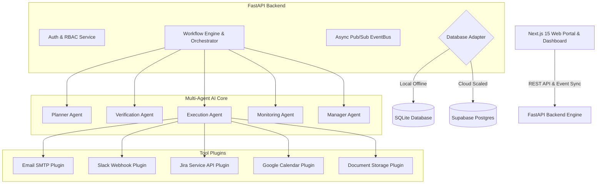

# 🚀 ECHO WorkforceOS

> **Enterprise Autonomous AI Workforce Orchestration Platform**
> 
> *Automating employee onboarding, cross-system provisioning, compliance verification, and HR operations through a multi-agent AI framework.*

---

## 📸 Overview

**ECHO WorkforceOS** is a production-grade, enterprise-ready autonomous AI workforce platform. Designed to eliminate manual HR administrative overhead, ECHO orchestrates specialized AI agents (Planner, Verification, Execution, and Monitoring) to autonomously manage the end-to-end employee lifecycle.

From instant invitation dispatch and document verification to IT identity provisioning (Slack, Jira, Google Calendar) and manager approval routing, ECHO executes enterprise workflows deterministically with zero human intervention required unless policy explicitly mandates it.

---

## ✨ Key Features

- **🤖 Autonomous Multi-Agent Core**: 5 specialized AI agents (Planner, Verification, Execution, Monitoring, Manager) collaborating via a DAG execution runtime.
- **⚡ Dual-Mode Persistence**: Zero-dependency local execution via SQLite/SQLAlchemy with instant cloud scaling to Supabase PostgreSQL.
- **🌐 Public Employee Portal**: Mobile-responsive, token-authenticated self-service portal (`/portal/[token]`) for profile completion and document upload.
- **🛡️ Enterprise Verification Engine**: Automated compliance checks for government IDs, tax forms, NDAs, and role-based policy rules.
- **🔌 Extensible Tool Plugins**: Pre-built integration plugins for Email (SMTP), Slack, Jira, Google Calendar, and Secure Document Storage.
- **🔔 Realtime Event Bus & Alerts**: Async event-driven architecture delivering live dashboard telemetry, workflow step updates, and notification feeds.
- **🔁 Resilient Failure Recovery**: Exponential backoff retry policies, transient error isolation, and automated human-in-the-loop escalation routing.

---

## 🏗️ System Architecture



---

## 🛠️ Technology Stack

### Backend Engine
- **Framework**: Python 3.11 / FastAPI
- **Data Validation**: Pydantic v2
- **Persistence**: SQLAlchemy 2.0 (SQLite) & Supabase Python SDK
- **Security**: PyJWT, Passlib (Bcrypt)
- **Async Runtime**: Asyncio & Uvicorn

### Frontend Application
- **Framework**: Next.js 15 (App Router, Turbopack)
- **UI & Components**: React 19, TailwindCSS, Lucide Icons, Shadcn UI
- **State & Data Fetching**: TanStack React Query v5, Axios
- **Design System**: Dark/Light mode glassmorphism typography design system

---

## 💻 Quick Start & Running Locally

### Prerequisites
- Python 3.11+
- Node.js 18+

### 1. Clone & Set Up Environment

```bash
# Clone the repository
git clone https://github.com/your-org/echo-workforceos.git
cd echo-workforceos

# Copy environment configurations
cp .env.example .env
cp .env.example backend/.env
cp .env.example frontend/.env.local
```

### 2. Launch Backend API Server

```bash
cd backend
python3 -m venv venv
source venv/bin/activate
pip install -r requirements.txt

# Start FastAPI development server (runs on http://127.0.0.1:8000)
python3 -m uvicorn main:app --reload --port 8000
```

### 3. Launch Frontend Web App

```bash
cd frontend
npm install

# Start Next.js development server (runs on http://localhost:3000)
npm run dev
```

---

## 🤖 AI Agents Overview

| Agent Name | Role & Responsibility | Primary Output |
| :--- | :--- | :--- |
| **Planner Agent** | Analyzes employee metadata & department to compile a DAG execution plan. | Topological Task Graph (`ExecutionPlanState`) |
| **Verification Agent** | Validates uploaded documents, ID compliance, and required profile fields. | Compliance Report (`VerificationReportState`) |
| **Execution Agent** | Dispatches tasks to external tool plugins (Email, Slack, Jira, Calendar). | Plugin Execution Result |
| **Monitoring Agent** | Tracks step duration, detects transient failures, and applies backoff retries. | Telemetry & Health Metrics |
| **Manager Agent** | Evaluates policy rules requiring human approval and routes approval requests. | Human-in-the-loop Escalation |

---

## 🔄 End-to-End Onboarding Workflow

1. **HR Invitation**: HR Manager dispatches an invitation link/QR code to a new employee.
2. **Employee Portal**: Employee accepts invitation, fills out profile details, and uploads required verification documents.
3. **DAG Generation**: Planner Agent compiles a custom 13-step execution plan tailored to the employee's department and job role.
4. **Verification**: Verification Agent validates uploaded document authenticity and policy compliance.
5. **Tool Execution**: Execution Agent provisions accounts (Slack, Jira, Email welcome packet, Google Calendar intro).
6. **Approval & Activation**: Workflow completes autonomously or pauses for manager approval when policy dictates, resulting in status `ACTIVE`.

---

## 🗺️ Roadmap

- [x] Multi-Agent DAG Orchestration Runtime
- [x] Public Employee Onboarding Portal (`/portal/[token]`)
- [x] Dual Storage Engine (SQLite + Supabase)
- [x] Integration Plugins (Email, Slack, Jira, Storage, Calendar)
- [ ] Enterprise SSO / SAML 2.0 Integration
- [ ] LangGraph Custom Agent Routing Extensions
- [ ] Multi-Language Employee Portal Support
